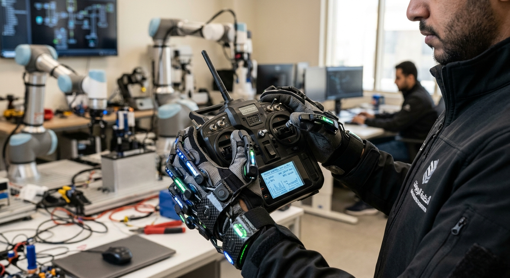

# 🦾 Smart Glove & Robotic Hand Control System

<p align="center">
  
</p>

<p align="center">
  <strong>Real-Time Hand Gesture Control Using Arduino and Robotics</strong>
  <br>
  <em>Embedded Systems • Robotics • Sensor Integration • Hardware Control</em>
</p>

<p align="center">
  
  
  
  
</p>

---

## 🌟 About the Project

The **Smart Glove & Robotic Hand Control System** is an Arduino-based embedded systems project designed to capture human finger movements using a sensor-equipped glove and reproduce those movements on a robotic hand.

The system uses **flex sensors** to measure finger bending, an Arduino microcontroller to process analog signals, and servo motors to control the robotic fingers.

This project demonstrates the practical integration of sensors, microcontrollers, actuators, analog-to-digital conversion (ADC), and pulse-width modulation (PWM) in a real-time robotics application.

## ✨ Key Features

- 🖐️ **Real-Time Motion Mirroring** — Translate finger movements into corresponding robotic finger movements.
- 📐 **Analog Signal Processing** — Read and map flex sensor values to servo motor angles.
- 🦾 **Robotic Finger Control** — Control individual fingers using servo motors.
- ⚙️ **Servo Calibration** — Adjust sensor ranges and servo angles to improve movement accuracy.
- 🔌 **Hardware Integration** — Connect sensors, microcontrollers, actuators, and external power supplies.
- 🧠 **Embedded Programming** — Implement sensor reading and motor control using Arduino C++.

## 🛠️ Hardware Requirements

| Component | Quantity | Purpose |
|---|---:|---|
| Arduino Uno / Mega / Nano | 1 | Reads sensor values and controls the robotic hand |
| Flex Sensors | 5 | Detect finger bending |
| Servo Motors (SG90 / MG996R) | 5 | Move the robotic fingers |
| 10 kΩ Resistors | 5 | Build voltage-divider circuits for flex sensors |
| External 5V Power Supply | 1 | Supplies power to the servo motors, as required |
| Breadboard | 1 | Simplifies circuit connections |
| Jumper Wires | As needed | Connect the electronic components |
| Sensor Glove | 1 | Holds the flex sensors on the fingers |
| Robotic Hand Structure | 1 | Provides the mechanical finger assembly |

**Important:** The servo motors may draw more current than the Arduino can safely provide. Use a suitable external supply for the servos and connect the power supply ground to the Arduino ground when required by the circuit design.

## 🏗️ System Architecture

The system operates through a simple sensor-to-actuator pipeline:

```text
             🖐️ SENSOR-EMBEDDED GLOVE
                        |
                        v
                 FLEX SENSORS
             Measure Finger Bending
                        |
                        v
              ANALOG INPUTS (A0–A4)
                        |
                        v
              ┌────────────────────┐
              │   ARDUINO BOARD    │
              │                    │
              │  Read Sensor Data  │
              │  Map Sensor Values │
              │  Calculate Angles  │
              └─────────┬──────────┘
                        |
                        v
                PWM SERVO SIGNALS
                  D3, D5, D6, D9, D10
                        |
                        v
              ┌────────────────────┐
              │   SERVO MOTORS     │
              │                    │
              │  Move Robotic      │
              │  Fingers            │
              └─────────┬──────────┘
                        |
                        v
                🦾 ROBOTIC HAND
              Mirrors Finger Motion
```

## 🔌 Wiring & Pin Configuration

The following pin mapping is the proposed configuration for a five-finger implementation.

| Finger | Flex Sensor Analog Pin | Servo Signal Pin |
|---|---|---|
| Thumb | `A0` | `D3` |
| Index | `A1` | `D5` |
| Middle | `A2` | `D6` |
| Ring | `A3` | `D9` |
| Pinky | `A4` | `D10` |

### Flex Sensor Connections

Each flex sensor should be connected as part of a voltage-divider circuit.

1. Connect one side of the sensor circuit to the appropriate supply voltage.
2. Connect the sensor and a 10 kΩ resistor to form a voltage divider.
3. Connect the divider's output to its assigned Arduino analog input (`A0`–`A4`).
4. Verify the voltage-divider arrangement and resistor placement against your specific sensor and circuit.

### Servo Motor Connections

1. Connect each servo's signal wire to its assigned digital pin.
2. Connect the servo power wires to a suitable supply within the servos' voltage and current specifications.
3. Ensure a common ground between the Arduino and the external servo supply.
4. Check the mechanical limits of each finger before running the system.

**Note:** Actual sensor readings, servo directions, and angle ranges depend on the hardware, mechanical design, and calibration.

## 🚀 Getting Started

### Prerequisites

Install the following tools and prepare the required hardware:

- [Arduino IDE](https://www.arduino.cc/en/software)
- Compatible Arduino board and USB cable
- Flex sensors and servo motors
- Required resistors, wiring, and power supply

### 1️⃣ Clone the Repository

```bash
git clone YOUR_REPOSITORY_URL
cd arduino-hand-gloves
```

Replace `YOUR_REPOSITORY_URL` with the URL of your GitHub repository.

### 2️⃣ Open the Arduino Project

Open the following file in Arduino IDE:

```text
main_glove_control.ino
```

### 3️⃣ Select the Board and Port

In Arduino IDE:

1. Open **Tools → Board** and select your Arduino model.
2. Open **Tools → Port** and select the connected device.
3. Confirm that the selected board and port match your hardware.

### 4️⃣ Verify and Upload the Firmware

Click **Verify** to compile the sketch, then click **Upload** to transfer the firmware to the Arduino.

You can also use the keyboard shortcut `Ctrl + U` to upload the sketch.

### 5️⃣ Test the System

1. Place the glove on your hand.
2. Power the Arduino and the servo supply.
3. Bend each finger gradually.
4. Observe the corresponding robotic finger.
5. Adjust sensor mapping and servo angles if necessary.

## ⚙️ Sensor Mapping & Calibration

Flex sensors do not necessarily produce the same readings when bent by the same amount. Calibration is therefore important for accurate movement.

Recommended calibration procedure:

1. Record each sensor's analog reading when its finger is straight.
2. Record the reading at a comfortable bent position.
3. Configure the input range for each sensor.
4. Map the calibrated readings to suitable servo angles.
5. Test the movement gradually and adjust the limits to prevent mechanical strain.

A basic Arduino mapping approach is:

```cpp
int sensorValue = analogRead(A0);

int servoAngle = map(
    sensorValue,
    sensorStraightValue,
    sensorBentValue,
    0,
    180
);

servoAngle = constrain(servoAngle, 0, 180);
```

**Note:** `sensorStraightValue` and `sensorBentValue` are placeholders; replace them with measured calibration values. Reverse the mapping direction if the sensor readings decrease when bent. The actual safe servo angle range may be narrower than 0–180 degrees.

## 📂 Project Structure

```text
arduino-hand-gloves/
│
├── README.md
├── docs/
│   └── images/
│       └── banner.png
│
└── main_glove_control.ino
```

| File / Directory | Description |
|---|---|
| `README.md` | Project documentation and setup guide |
| `docs/images/banner.png` | Project banner displayed on GitHub |
| `main_glove_control.ino` | Main Arduino firmware for reading sensors and controlling servos |

*This structure assumes the Arduino sketch and image are stored at the listed locations; adjust the paths to match your actual repository.*

## 🎯 Project Objectives

- 🤖 Understand robotics and actuator control.
- 📟 Read and process analog signals using the Arduino ADC.
- 🖐️ Capture human finger movements through flex sensors.
- ⚙️ Control servo motors using PWM-compatible signal outputs.
- 🔌 Integrate electronic components into a functional embedded system.
- 🧪 Apply calibration and testing to improve motion tracking.

## 🔮 Future Improvements

- 📡 Add wireless communication between the glove and robotic hand.
- 📈 Implement sensor filtering to reduce noisy readings.
- 🎛️ Add adjustable sensitivity and servo angle limits.
- 🔋 Improve power management and battery integration.
- 🦾 Enhance the robotic hand's mechanical design and movement precision.

## 🔐 Safety Considerations

- Use a power supply appropriate for the servo motors.
- Check wiring and polarity before powering the circuit.
- Keep fingers clear of moving mechanical parts during testing.
- Start with conservative servo angle limits.
- Disconnect power before changing wiring or repairing the mechanism.

---

<p align="center">
  <strong>🦾 Smart Glove & Robotic Hand Control System</strong>
  <br>
  <em>Bridging human movement and robotics through embedded systems.</em>
</p>
